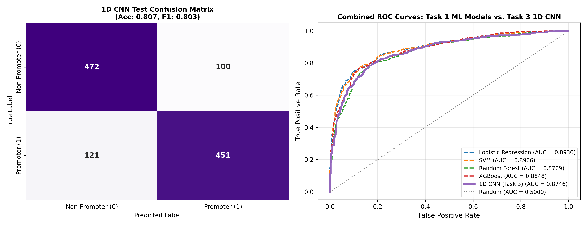
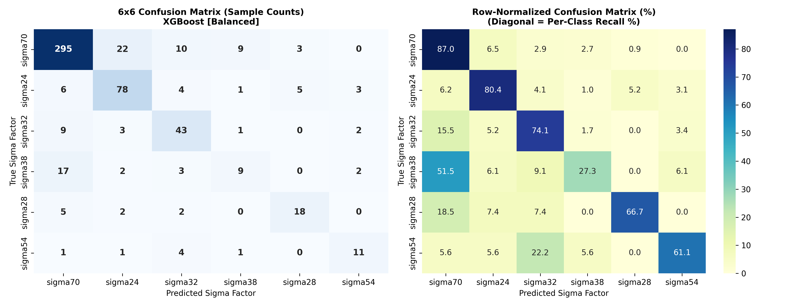
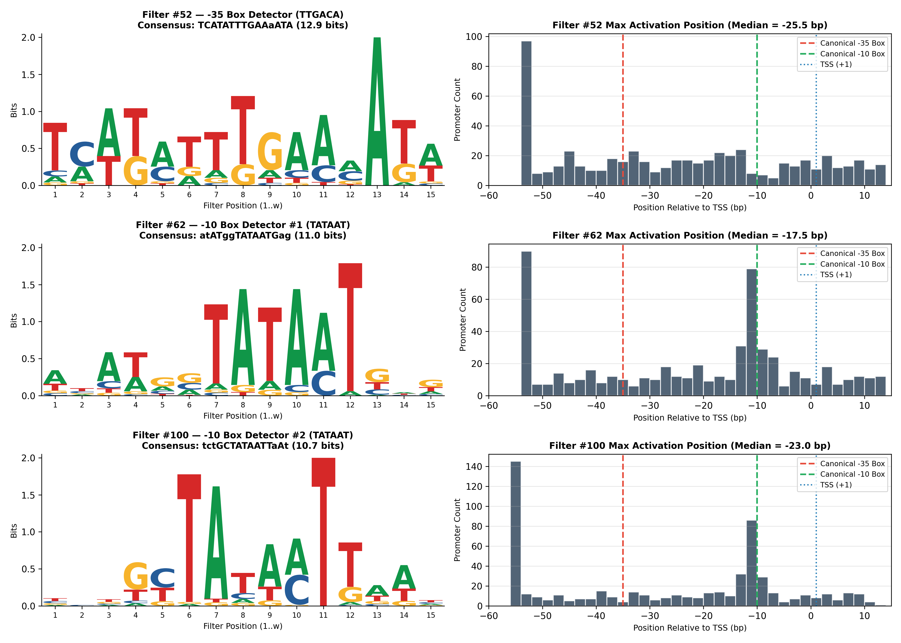
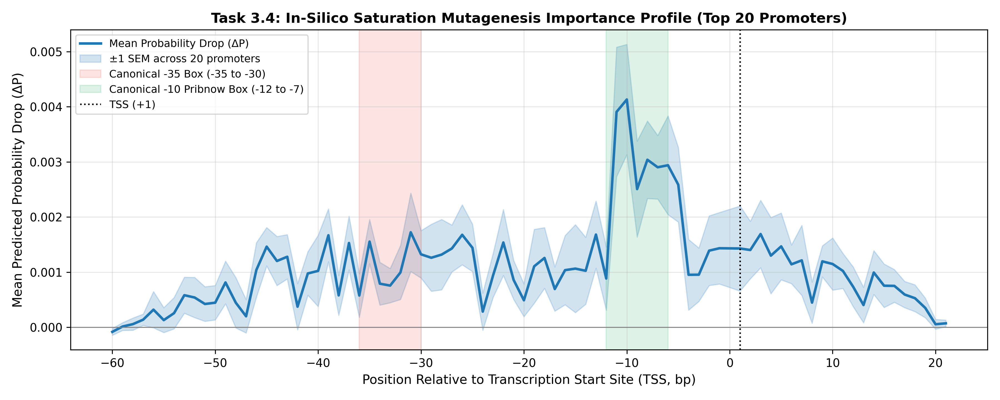

# *E. coli* Promoter Classification & Motif Discovery

**Author:** Alireza Salahi  
**Course:** Bioinformatics — Project 1  
**Dataset:** *Escherichia coli* K-12 Promoters (RegulonDB / iPromoter-2L Benchmark)

A machine-learning and deep-learning pipeline for identifying bacterial promoter sequences, classifying six *E. coli* sigma ($\sigma$) factors under severe class imbalance, and discovering biological promoter motifs directly from raw DNA sequences using interpretable 1D Convolutional Neural Networks (CNNs).

---

## Project Overview

All sequences are **81 bp** long and aligned at the Transcription Start Site (**TSS, `+1`** at index `60`), spanning **`-60` to `+20` bp**. All preprocessing, feature scaling, cross-validation, and class-weighting steps are fitted strictly on the provided 80% training split to prevent data leakage.

| Task | Problem | Dataset | Best Approach | Key Result |
| :--- | :--- | :--- | :--- | :--- |
| **Task 1** | Promoter vs. Non-Promoter (Binary) | 5,719 sequences (50/50 balanced) | RBF SVM (140 engineered features) | **Acc: 81.82%**, **F1: 0.8129**, **AUC: 0.8906** |
| **Task 2** | 6-Class Sigma-Factor Classification | 2,858 promoters (18.2:1 imbalance) | Balanced XGBoost (150 engineered features) | **Macro-F1: 0.6594**, **Macro-Rec: 0.6610** |
| **Task 3** | End-to-End 1D CNN & Motif Discovery | 5,719 sequences ($4 \times 81$ one-hot) | 1D CNN (`w = 15`) / CNN-BiLSTM | **CNN AUC: 0.8746** / **CNN-BiLSTM AUC: 0.8801** |

---

## Key Highlights & Results

### Task 1: Binary Promoter Classification (`notebooks/Task1.ipynb`)
* **140-Dimensional Biophysical Feature Representation:**
  * Overlapping **3-mer frequencies** (64 features, selected over $k \in \{2, 3, 4, 5\}$ via 5-fold CV).
  * **Global composition & strand skew** (`A/C/G/T`, `GC`, GC-skew, AT-skew; 7 features).
  * **TSS-aligned 6-zone positional windows & local `-35`/`-10` dinucleotides** (62 features).
  * **Canonical $\sigma^{70}$ motif log-odds scores** (`TTGACA` at `-35`, `TATAAT` at `-10`; 2 features) and **SantaLucia nearest-neighbor DNA duplex melting free energy ($\Delta G_{37^\circ\text{C}}$)** across promoter zones (5 features).
* **Test Set Comparison (including Task 3 1D CNN):**

| Model | Accuracy | Precision | Recall | F1-Score | MCC | ROC-AUC |
| :--- | :---: | :---: | :---: | :---: | :---: | :---: |
| **SVM (RBF)** | **0.8182** | **0.8370** | 0.7902 | **0.8129** | **0.6374** | 0.8906 |
| **Logistic Regression** | 0.8129 | 0.8231 | **0.7972** | 0.8099 | 0.6262 | **0.8936** |
| **XGBoost** | 0.8138 | 0.8330 | 0.7850 | 0.8083 | 0.6287 | 0.8848 |
| **1D CNN (Task 3)** | 0.8068 | 0.8185 | 0.7885 | 0.8032 | 0.6141 | 0.8746 |
| **Random Forest** | 0.8042 | 0.8258 | 0.7710 | 0.7975 | 0.6097 | 0.8709 |



---

### Task 2: Sigma-Factor Classification (`notebooks/Task2.ipynb`)
* Extended the Task 1 feature framework with consensus motif scanners for all six target sigma factors ($\sigma^{70}, \sigma^{24}, \sigma^{32}, \sigma^{38}, \sigma^{28}, \sigma^{54}$; **150 features total**).
* Evaluated **Unweighted vs. Inverse-Frequency Balanced Class Weights** across Logistic Regression, SVM, Random Forest, and XGBoost (SMOTE was also tested empirically and underperformed balanced class weights).
* **Balanced XGBoost** achieved the highest Macro-F1 (**0.6594**, Accuracy **79.37%**, Macro-Recall **0.6610**), improving recall across all five minority sigma factors.
* Error analysis confirmed that the dominant confusion ($\sigma^{38} \to \sigma^{70}$ at **51.5%**) reflects their shared evolutionary `-10` binding specificity (`CTATACT` vs. `TATAAT`).



---

### Task 3: 1D CNN, Motif Discovery & Bonus Extensions (`notebooks/Task3.ipynb`)
* **Filter Logos & Spatial Activation:** First-layer `Conv1d(4, 128, kernel_size=15)` filters spontaneously recovered the canonical **$-10$ Pribnow box (`TATAAT`, Filters #62 & #100)** peaking sharply at `-10` bp relative to the TSS, as well as a partial **$-35$ box (`TTGAA`, Filter #52)**.
* **In-Silico Saturation Mutagenesis:** Averaging across the 20 highest-confidence test promoters revealed a dominant causal peak across **`-11` to `-5` bp** (peaking at `-10` bp) with a secondary peak inside the `-35` box (`-31` bp).
* **Bonus Extensions Implemented:**
  1. **CNN-BiLSTM:** Replaced global max pooling with local pooling + BiLSTM to capture motif spacing (**F1: 0.8079**, **ROC-AUC: 0.8801**).
  2. **Positional 1D CNN for Task 2:** Achieved **0.7091 Macro-Recall** and **0.6472 Macro-F1** directly from raw one-hot sequences.
  3. **MEME Suite TomTom (PRODORIC):** Exported top 15 filters (`results/task3_learned_filters.meme`) and validated AT-rich UP-element/melting motifs (`Filter_26`, $q = 0.0289$; `Filter_23`, $q = 0.0547$) and *E. coli* `CitB` alignment (`Filter_100`, $p = 4.34 \times 10^{-3}$).
  4. **Binary $\sigma^{54}$-vs-$\sigma^{70}$ CNN:** Achieved **0.9245 ROC-AUC** and cleanly recovered the canonical $\sigma^{54}$ **$-24$ box (`TGGCAC`, 13.4 bits)** centered at `-26.0` bp.





---

## Repository Structure

```text
ecoli-promoter-classification/
├── data/
│   ├── task1_promoter.csv
│   ├── task2_sigma.csv
│   └── README.txt
├── notebooks/
│   ├── Task1.ipynb
│   ├── Task2.ipynb
│   └── Task3.ipynb
├── results/
│   ├── figures/                       # All generated plots (.png)
│   ├── task1_metrics_table.csv
│   ├── task1_and_task3_comparison.csv
│   ├── task2_macro_metrics_table.csv
│   ├── task2_per_class_metrics_table.csv
│   ├── task3_learned_filters.meme
│   └── tomtom.tsv
├── report/
│   └── Project1_Report.pdf            # Full LaTeX-compiled project report
├── .gitignore
├── requirements.txt
└── README.md